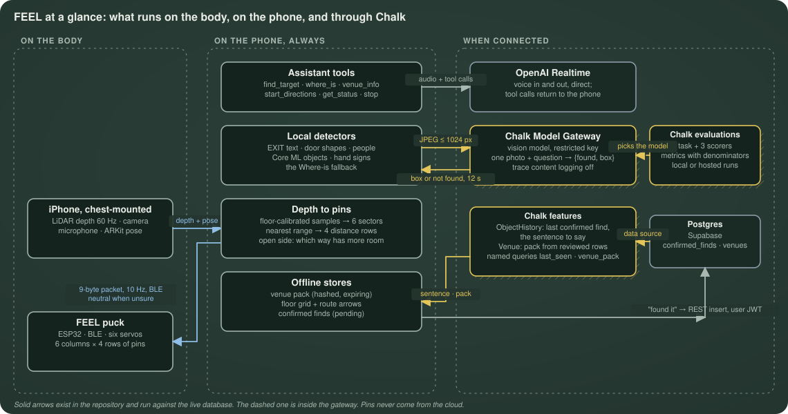
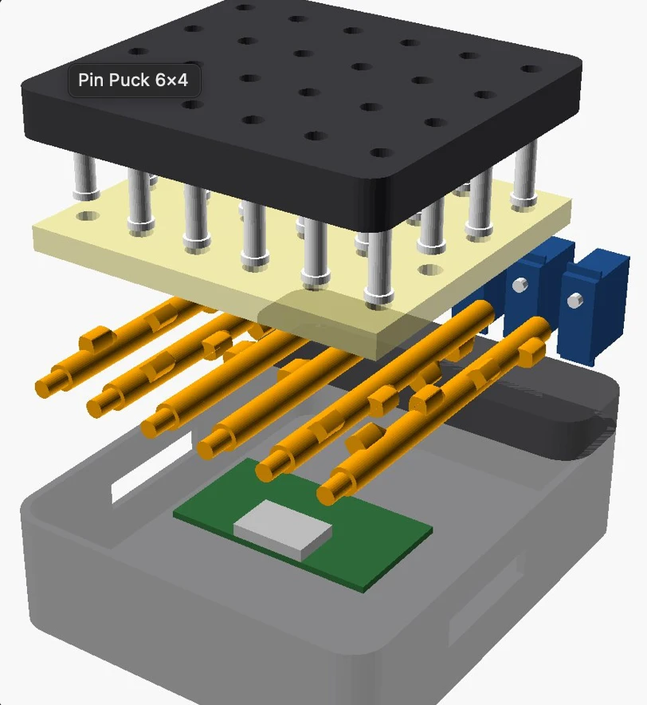
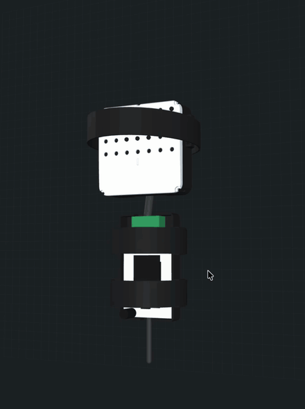
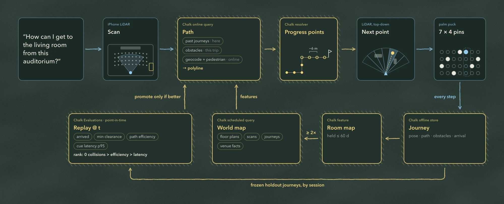

# FEEL: A Second Sense, Powered by AI

### 🏆 HackHarvard 2026: Overall 1st Place · Best Hardware Track · Best Use Of Chalk (2nd)

**An on-palm radar. Keep your ears. Feel the room.**

FEEL is a HackHarvard 2026 prototype that turns an iPhone's depth readings into touch.
A handheld puck has six servo-driven columns with four pins each; each column can raise
one pin to represent the nearest obstacle in that direction. The iPhone sends commands
over Bluetooth to an ESP32, leaving environmental sounds available to the user.

The app also includes object finding, saved places and voice commands. Chalk routes
photo questions to a vision model and supports context retrieval and evaluation tools;
OpenAI Realtime handles the live voice conversation. Software implementation and physical
validation have separate status throughout this README.

> FEEL is an experimental prototype for supervised indoor use. It is not a certified mobility
> aid and does not replace a cane or guide dog. See [what has been verified](#verification-status).

## Why another approach

| Common approach | Where it falls short |
|---|---|
| Camera → cloud model → spoken narration | Seconds of delay. It talks over the sounds you navigate by, and can confidently say "clear" when it isn't. |
| Distance sensor + vibration motor | One bit: "something is near." No direction, distance or *what*. |
| Devices that steer you | Handle the path straight ahead and decide for you. They can't find a goal across the room. |

## What the app includes

| Feature | Implementation and limits |
|---|---|
| Obstacle sensing and touch | On-device LiDAR processing maps six directions to four distance bands. The firmware stops its live outputs after 500 ms without accepted commands; software checks don't prove that a physical pin returned. |
| Object finding | A photo question can use Chalk's Model Gateway, with local detection as fallback. Live accuracy and phone-to-puck guidance still need validation. |
| Saved places | Session bookmarks support remember, move and recall. Saved-room restoration requires relocalization and fresh tracking before guidance. These features don't guarantee a safe route. |
| Voice and optional cloud context | OpenAI Realtime provides conversation; local commands and opt-in cloud memory have separate setup requirements. Chalk context reads require activation and end-to-end testing. |

Useful V2/V3/V4 features now live in `main`; older branches remain available. See
[version integration](docs/VERSION-INTEGRATION.md) for the feature list, evidence and
configuration requirements.

## How it works



1. **Sense.** ARKit scene depth on the iPhone keeps points 0.6–2.1 m above the calibrated floor,
   splits the camera's ±45° field into six 15° sectors, and takes the nearest range in each.
2. **Encode.** Each sector's range becomes a distance row. A selected target sets a highlight
   column. The phone sends a 9-byte Bluetooth packet ten times a second.
3. **Touch.** An ESP32 drives one servo per column. Each servo turns a cam shaft that raises
   exactly one of four pins. The highlighted column taps.

| Distance to nearest obstacle | Pin row (wrist → fingers) |
|---|---|
| under 0.9 m | 1 |
| 0.9–1.6 m | 2 |
| 1.6–2.5 m | 3 |
| 2.5–4.0 m | 4 |
| missing, invalid or beyond 4 m | none (column stays down) |

A column that stays down means *no pin request*, not *clear space*. The phone announces lost
tracking, stale depth and disconnection separately.

More figures: [sensing to pins](docs/diagrams/sensing-to-pins.svg),
[one Where-is request](docs/diagrams/where-is-path.svg),
[the evaluation loop](docs/diagrams/chalk-eval-loop.svg) and
[memory and venue knowledge](docs/diagrams/chalk-context.svg).

## Hardware



<p align="center">
  
</p>

Full clip with the layer toggles and the forearm pack: [puck-assembly.mp4](docs/media/puck-assembly.mp4) (24 s, 0.5 MB).

| Part | Spec |
|---|---|
| Phone | iPhone with LiDAR (developed on an iPhone 14 Pro Max), held landscape-left, rear camera forward |
| Controller | ESP32-WROOM (classic ESP32) with Bluetooth LE, powered over its own USB lead |
| Actuators | 6 × FEETECH FS0307 sub-micro servos (Pololu 3420): 4.8–6 V, 0.4–0.5 A stall each |
| Tactile display | 6 columns × 4 rows = 24 pins. One servo and one cam shaft per column, so one pin per column is up at a time |
| Servo power | 5 V / 4 A wall supply on a separate servo bus, 1000 µF bulk capacitor, ground shared with the ESP32 |
| Housing | 3D-printed PLA puck, chassis 100.5 × 92.5 × 26.7 mm, worn on the palm with a strap; ESP32 and wiring in a forearm pack tray |
| Pins | 4.2 mm pins in holes reamed to 4.37 mm (11/64″) |

The housing has seven column positions; the leftmost is left empty and GPIO32 is unused.
Wiring, left to right: GPIO33, 25, 26, 27, 14, 13 ([layout and wiring](docs/SIX-COLUMN-LAYOUT.md)).

The firmware currently assumes 175° servo travel over 650–2500 µs, based on user-observed
wider motion. FEETECH rates the FS0307 at 120° over 900–2100 µs, and our units' travel has not
been measured. [The travel test](docs/SERVO-TRAVEL-TEST.md) decides which cam shaft to print.

### Link and safety

- **Protocol:** BLE, 9-byte frame `[seq, 0, b1…b6, highlight]` at 10 Hz. Stale sensor results
  are dropped, never queued. Wire cases live in [`protocol/vectors.json`](protocol/vectors.json);
  policy in [PROTOCOL.md](docs/PROTOCOL.md).
- **Validation:** the firmware rejects malformed, duplicate and out-of-order packets atomically.
- **Watchdog:** after 500 ms without an accepted packet, or on disconnect, every column returns
  to a neutral gap. Reconnection starts neutral and waits for a fresh packet.
- **Output guard:** servo PWM is off by default. Production output builds only with each unit's
  measured pulse limits.
- **Known limit:** the puck has no position, force or current sensing, so it can't detect a
  jammed pin. See [known issues](docs/KNOWN-ISSUES.md).

## Cost

About **$95 in parts**, not counting the iPhone.

| Part | Qty | Unit | Total | Basis |
|---|---|---|---|---|
| FEETECH FS0307 servo | 6 | $9.35 | $56.10 | Pololu list price, 5+ units |
| ESP32-WROOM USB-C dev board | 1 | ~$8 | ~$8 | Typical retail range $5–12 |
| 5 V / 4 A switching supply | 1 | $14.95 | $14.95 | Adafruit list price |
| Barrel-to-screw-terminal adapter | 1 | ~$2 | ~$2 | Estimate |
| 1000 µF capacitor, 22 AWG wire, perfboard, headers | — | — | ~$3 | Estimate |
| PLA filament, 8 printed parts | ≤ 210 g | $20/kg | ≤ $5 | Upper bound: every part solid, from CAD volumes |
| Strap, foam, M3 screws | — | — | ~$5 | Estimate |
| **Total** | | | **≈ $94** | |

Prices checked October 17, 2026, before shipping and tax. Not included: the LiDAR iPhone, a
spare servo, a battery bank for walking use ([power options](docs/BATTERY.md)), and printer time.
For context, commercial refreshable braille displays, the closest pin-based devices, start
around $1,500, though they display text rather than space.
Sources: [Pololu FS0307](https://www.pololu.com/product/3420),
[Adafruit 5 V 4 A supply](https://www.adafruit.com/product/1466),
[braille display buyer's guide](https://www.disabilityworld.org/articles/refreshable-braille-displays-buyers-guide/).

## How we use Chalk

Chalk supports object finding, context retrieval and model evaluation in FEEL. These
parts have different validation status; implementing a request path doesn't prove
that it works through the phone and physical puck.

### Finding objects

When you ask “Where is the chair?”, the voice assistant's `where_is` tool sends a
camera photo and the question through Chalk's Model Gateway to the configured vision
model. The iPhone combines the returned image location with LiDAR depth to locate the
target and generate tactile guidance. We've implemented this path; live photo accuracy
and the complete phone-to-puck flow still need physical validation.

If Chalk isn't configured or the request fails, the app falls back to its local finder.
The phone and gateway request share a 12-second deadline.

### Retrieving context

For a question such as “Where did I last see my keys?”, Chalk's context queries can
retrieve previous finds, room information and journey data. Five direct-engine
synthetic context checks passed. Those checks don't establish that the complete phone
flow works: context reads still require activation, credentials and end-to-end testing.
Shared-room and private last-seen reads require explicit opt-in and an authenticated
server endpoint; service credentials stay off the phone.

### Evaluating models

We built evaluation tools to compare model answers, localization accuracy and response
time on the same cases. They also count false finds: answers that claim an object is
present when it isn't. A completed hosted FEEL evaluation remains unverified, so we
don't claim measured model quality or latency from the local checks.

Live voice conversation uses OpenAI Realtime directly. Chalk handles the model requests
and context described above; the iPhone handles immediate sensing and the ESP32 drives
the tactile outputs.



See [implementation and validation status](docs/VERSION-INTEGRATION.md) for evidence and
remaining work, or [Chalk setup and evaluation commands](chalk/README.md) to run it.

## Limitations

We built FEEL in a weekend from parts we could buy in person: Micro Center, Walmart and hardware
stores in Cambridge. That shaped the mechanism:

- **The cam rods are big.** Each column is driven by a 3D-printed cam rod about 11 × 11 × 58 mm.
  The rods, not the pins, set the 12 mm column spacing and most of the puck's size.
- **One servo per column means one pin per column.** Each servo turns one rod, and the rod can
  raise only one of its four pins. A column shows only the nearest obstacle in that direction,
  so a chair close by hides the door behind it. Moving between distant rows also sweeps the cam
  past the rows in between.
- **No feedback from the pins.** The servos report nothing back, so the puck can't tell whether
  a pin actually rose or jammed.

With more time and freedom to test, we would:

1. **Shrink the rods.** Machined metal shafts, or finer resin-printed cams, would cut the column
   spacing and puck thickness. That leaves room for more columns and finer direction.
2. **Drive each pin on its own.** One small actuator per pin, such as a micro solenoid or a
   shape-memory-alloy pin, would let a column show near and far together, with no sweep between
   rows. It costs more actuators and more power, so we would prototype one column first.
3. **Measure the mechanism.** Servo travel, pin lift, phone-to-pin latency and supply behaviour
   with every servo moving, plus position sensing to catch a jammed pin.
4. **Test with blind users.** Which spacing, stroke and tap rhythm people can read, and how many
   directions are actually useful, should set the next design. Our own fingers shouldn't.

## Verification status

What has run, and what hasn't:

- **Passes:** software checks on the Swift core, C++ controller, cross-layer replay and CAD
  geometry. Exact counts and commits are in [release status](docs/RELEASE-STATUS.md).
- **Previously observed on hardware:** user-reported servo movement under phone control.
  The latest hardware session has unresolved power/startup failures; a dim LED alone
  does not establish board damage. Physical readiness remains unverified.
- **Not yet measured:** six-servo travel and mechanics, servo supply under load, sensing
  accuracy, end-to-end latency, hosted evaluation results, and testing with blind users.

The [production replay](validation/production/README.md) runs the real Swift encoder and C++
controller on recorded and synthetic scenes. It is labeled as simulation and is not a recording
of real pins. [Grid walk](docs/GRID-WALK.md) tests the guidance on the phone screen without a puck.

## Run it

Requirements: Swift 5.9+ (6.1.3 used locally), a C++11 compiler, Python 3.10+, OpenSCAD
2021.01+ and PlatformIO 6.1.18. The iOS apps need macOS with Xcode and XcodeGen. Linux compiles
the same Swift core and C++ controller, but not the Apple frameworks.

```sh
sh ios/scripts/test_portable.sh
sh firmware/test/run_host_tests.sh
sh validation/adapters/run_contract_tests.sh
pio run -j 2 --project-dir firmware
sh cad/build.sh
python3 cad/tools/check_stl.py stl/*/*.stl
python3 cad/tools/cam_sim.py
python3 scripts/run_v1_checks.py   # exits 0 pass, 1 fail, 2 blocked or not run
```

Open `.artifacts/production/index.html` for the recorded offline replay.

On a Mac:

```sh
python3 scripts/fetch_model.py   # Apple Core ML model, pinned revision and SHA-256
bash scripts/check_ios.sh        # simulator tests and unsigned device builds
cd ios
xcodegen generate
open Lantern.xcodeproj
```

Select your signing team and a LiDAR iPhone in Xcode. The simulator can't show LiDAR, Bluetooth,
Nearby Interaction, tactile usability or mechanical behavior.

Hardware: [Mac and ESP32 setup](docs/SETUP-MAC-ESP32.md), [bring-up](docs/HARDWARE-BRINGUP.md),
[calibration](docs/CALIBRATION.md) and [app and servo test](docs/TEST-V1.md).

## Repository

| Path | Contents |
|---|---|
| [`ios/`](ios/README.md) | FEEL iPhone app (target `Lantern`), Beacon companion app, portable Swift core and tests |
| [`firmware/`](firmware/README.md) | Shared C++ controller, ESP32 Bluetooth adapter, host simulator and tests |
| [`cad/`](cad/README.md) | Parametric OpenSCAD puck, cams, pins, forearm pack, mesh and cam checks |
| [`chalk/`](chalk/README.md) | Chalk gateway client, evaluations, features and venue packs |
| [`protocol/`](protocol/vectors.json) | Normative packet vectors, the shared Where-is prompt and venue packs |
| [`services/voice-token/`](services/voice-token) | Small service that issues short-lived voice credentials |
| [`validation/`](validation/production/README.md) | Cross-layer replay of the real Swift and C++ code |
| [`web/`](web) | FEEL site with `/replay` |
| [`docs/`](docs) | All documentation: handoffs, protocol, hardware, release status, demo script and diagrams |

[Codebase guide](docs/CODEBASE.md) · [demo script](docs/DEMO.md) · [Devpost draft](docs/DEVPOST.md)

## Provenance

The FEEL concept and its design handoff ([HANDOFF-v7.md](docs/HANDOFF-v7.md)) predate this
repository. No original app, firmware or CAD source was available, so this code is a new
implementation written from that handoff. Third-party model weights keep their own source,
hash and license. See [eligibility and disclosure](docs/ELIGIBILITY.md).
