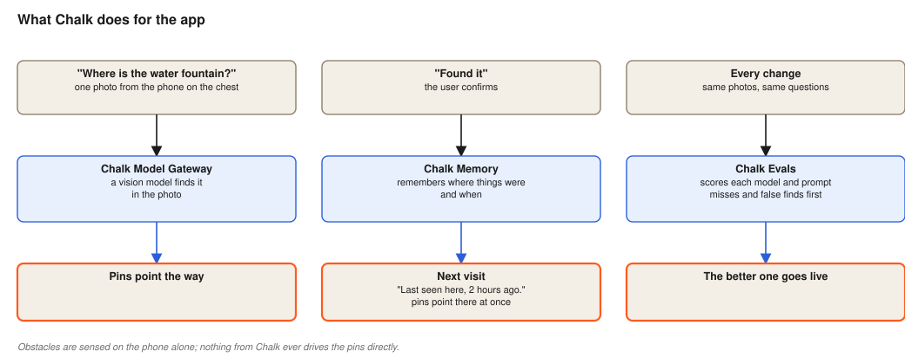
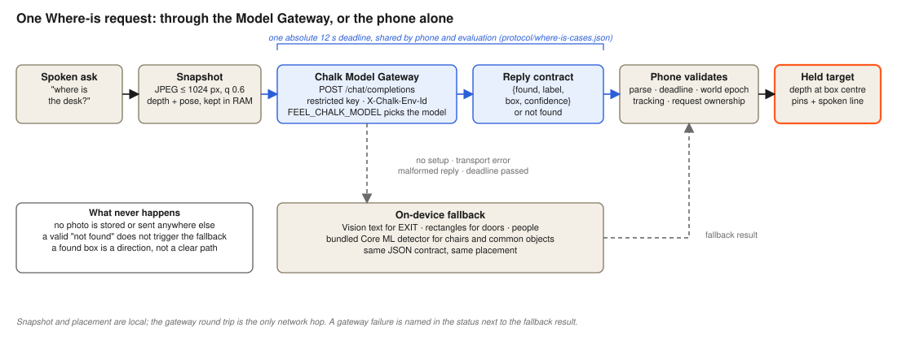
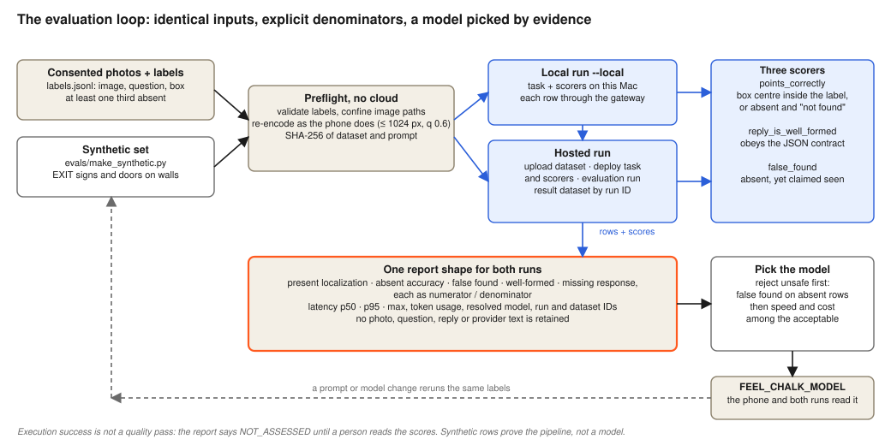
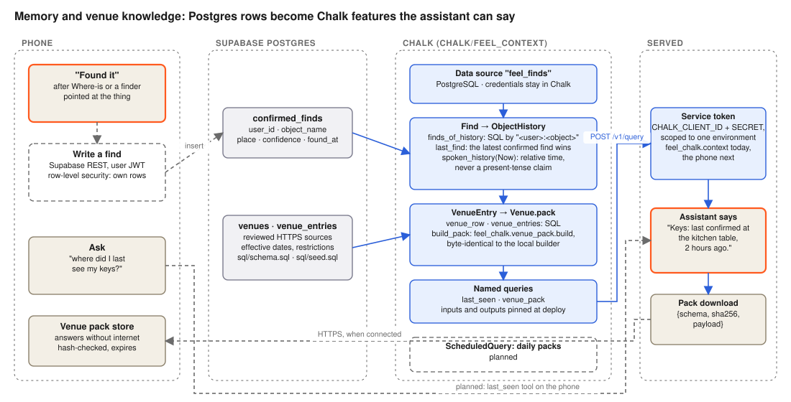

# FEEL Where-is with Chalk

> Production setup follow-up: trace content logging is now disabled, support has received the quota-backend blocker, and a synthetic infrastructure evaluation has been created. See [current production gates](../docs/CHALK-PRODUCTION.md). Historical statuses below describe the earlier audit.

Chalk routes the **photo Where-is** request to a vision model. FEEL's voice conversation uses OpenAI Realtime directly. V4 also has a separate Chalk-backed text interpretation service; that feature remains on its V4 branch.

See [implementation status, architecture diagrams and evaluation plan](../docs/CHALK-IMPLEMENTATION.md) for the complete split.

## Chalk in FEEL at a glance




| Chalk | Used for | Where |
|---|---|---|
| Model Gateway | The one photo of a Where-is question, behind a restricted key with a model allowlist and trace content logging off; the phone and the evaluation share one absolute 12 s deadline | `feel_chalk/gateway.py`, `../ios/Lantern/Services/ChalkGateway.swift` |
| Evaluations | The same task and three scorers run locally (`--local`) or hosted; one report shape with explicit denominators, latency, usage and resolved model | `feel_chalk/where_is_eval.py`, `feel_chalk/eval_report.py` |
| Features and named queries | Confirmed finds become `ObjectHistory` (latest find, spoken sentence); reviewed rows become `Venue.pack`, byte-identical to the local builder; shared room anchors become `RoomMemory` (median place per label at a printed tag, spoken summary) | `feel_context/`, `chalk.yaml`, `sql/` |
| Context client | Token exchange and online queries from this Mac today, the phone next | `feel_chalk/context.py` |







The figures are drawn by `../docs/diagrams/make_diagrams.py`; edit it and rerun rather than the SVGs.

## Current status

On October 17, 2026, Team **Feel**, project **Default**, environment **production** (`flnyc749e8d9`) has a working **FEEL OpenAI** provider connection. The app key allows only `openai/gpt-6.1-sol` and `openai/gpt-6-luna`. Both answered a previously authorized generic text request. A read-only follow-up passed both router checks and found no datasets or hosted evaluations.

Current-environment photo inference, hosted evaluation scores and phone provisioning are **not verified**. Historical simulator results from another configuration do not establish these results. No additional model or provider credential is needed to start the two-model comparison.

## Implemented paths

| Piece | Source | What it does |
|---|---|---|
| Shared contract | `../protocol/where-is-prompt.txt`, `../protocol/where-is-cases.json` | Prompt and parser fixtures used by Swift and Python |
| Python gateway | `feel_chalk/gateway.py`, `feel_chalk/config.py` | Authenticated model listing and chat requests |
| Parser and scoring | `feel_chalk/where_is.py` | Strict reply parsing and box-centre scoring |
| Phone preprocessing | `feel_chalk/images.py` | EXIF correction, long side at most 1024 px, JPEG quality 60 |
| Evaluation runner | `feel_chalk/where_is_eval.py` | Labeled photo task and three scorers; hosted execution still pending |
| Phone integration | `../ios/Lantern/Services/ChalkGateway.swift`, `WhereIsService.swift` | One frame + question, 12-second timeout, local fallback on configuration/transport/malformed-response failures |
| Portable phone contract | `../ios/Shared/FeelCore/Sources/FeelCore/WhereIs.swift` | Reply validation without networking |

The phone uses LiDAR depth and pose to place a returned box locally. A found box indicates direction, not a clear path. Valid not-found and missing-depth results do not trigger the fallback. Superseded requests cannot place a target in a newer session.

## Local setup

Use the existing Feel configuration on this machine. For a new checkout:

1. Copy `.env.example` to `.env` and set the restricted gateway key, selected environment and model. The service token
   (`CHALK_CLIENT_ID`, `CHALK_CLIENT_SECRET`) is only needed for context queries and hosted evaluations. Never commit `.env`.
2. Install the pinned requirements into a virtual environment using a compatible Python version.
3. Sign into the Chalk CLI and select the same environment used in `.env`. The installed CLI may be at `~/.chalk/bin/chalk` rather than on `PATH`.
4. Confirm access with the read-only check below. Only `--chat` requests inference.

```sh
cd chalk
python3 check_connection.py
python3 check_connection.py --chat
python3 -m unittest discover -s tests -v
```

The first command checks reachability, key/model listing, SDK and CLI login without generating tokens or sending photos. The second sends one small text request and may consume provider credit. Exit 0 means checks passed, 1 means failure, and 2 means setup is blocked. Listing a model does not verify its inference quality.

## Prepare the photo evaluation

Create `data/labels.jsonl` using `evals/labels.example.jsonl`. Images must be consented captures in ignored `data/`; the example references placeholder files and is not a runnable dataset. Boxes are normalized coordinates on the upright image. At least a third of rows must have `"box": null` for an absent target.

```sh
cd chalk
python3 evals/validate_labels.py data/labels.jsonl
python3 -m feel_chalk.where_is_eval data/labels.jsonl --preflight --output data/preflight.json
```

The standalone checker covers basic labels. Mandatory runner preflight additionally decodes every image, confines image paths to the label directory, and records input and prompt hashes. It never loads the cloud SDK or sends data. Use a fresh output filename for each report.

After approving the exact dataset upload, run the hosted comparison from `chalk/`:

```sh
python3 -m feel_chalk.where_is_eval data/labels.jsonl --model openai/gpt-6.1-sol --output data/sol-run.json
python3 -m feel_chalk.where_is_eval data/labels.jsonl --model openai/gpt-6-luna --output data/luna-run.json
```

Hosted mode uploads the dataset and deploys task/scorers. A failed run, missing rows or task/scorer errors returns nonzero. Reports retain run IDs and row scores without photo payloads or raw model text; detailed outputs remain in the Chalk result dataset. Exit zero means execution was complete, while quality remains `NOT_ASSESSED` until the scores and individual errors are reviewed.

Review and authorize the actual dataset before upload. The hosted runner sends normalized photos and questions to Chalk and its configured model provider. Run both models on identical labels, images and prompt; retain dataset hashes, run IDs, complete row results and failures. See the [evaluation plan](../docs/CHALK-IMPLEMENTATION.md#evaluation-design) for denominators and proposed acceptance criteria.

The scorers measure point correctness, valid reply structure and false-found count. The report's `metrics` give each rate with its numerator and denominator: present-target localization over present rows, absent accuracy and false-found over absent rows, well-formed replies and missing responses over all rows. A completed cloud job alone is not a quality pass. Photo scores do not validate LiDAR, speech delivery, BLE or physical tactile output.

Each task row records its status, elapsed time, the model the gateway resolved and token usage. The phone and the evaluation share one absolute deadline, `deadline_seconds` in `protocol/where-is-cases.json` (12 s). A reply after it is unusable: the phone falls back to its local finder, and the evaluation scores the row as a missing response. Gateway errors leave the run incomplete. The report adds `latency_ms` (p50, p95, max), summed `usage` and `resolved_models`.

## Synthetic dataset and a local run

The pipeline can be exercised today without consented photos: `evals/make_synthetic.py` renders walls with an
EXIT sign or a door drawn at a known place, or absent, in the exact label format. `--local` then runs the hosted
pipeline's task and scorers on this Mac through the gateway and writes the same report. Nothing is uploaded.

```sh
cd chalk
python3 evals/make_synthetic.py data/synthetic --rows 12 --seed 7
python3 -m feel_chalk.where_is_eval data/synthetic/labels.jsonl --preflight --output data/synthetic/preflight.json
python3 -m feel_chalk.where_is_eval data/synthetic/labels.jsonl --local --output data/synthetic/local-run.json
```

Recorded on October 17, 2026 in [docs/evidence/chalk-synthetic](../docs/evidence/chalk-synthetic/): 12 rows
(8 present, 4 absent) through `openai/gpt-6.1-sol`, all 12 replies in time and well formed, present localization 8/8,
absent accuracy 4/4, false found 0/4, latency p50 2.3 s and p95 3.4 s, 13,790 tokens. Synthetic rows prove the
pipeline end to end, not a model: real venue photos are still required before a model is selected.

## Context features: what the assistant remembers

`feel_context/` defines the Chalk features behind "where did I last see my keys?", the venue pack and room memory
(what was found near a printed FEEL tag on earlier visits), with `sql/schema.sql` and `sql/seed.sql` for the Postgres
they read and `feel_chalk/context.py` to query them. [feel_context/README.md](feel_context/README.md) explains what
the Supabase values in `.env` are for, what Chalk needs instead (the database connection, registered as the
`feel_finds` data source), the deploy steps, and how room memory works and what it stores.


## Venue pack

FEEL reads reviewed venue information without internet from a downloaded pack. Build one from a reviewed source file (format: `protocol/venue-pack-source.json`, a fictional test vector):

```sh
python3 -m feel_chalk.venue_pack data/reviewed-venue.json --days 7 --output data/venue-pack.json
```

Every entry needs an HTTPS source and its retrieval time; a `restriction` needs the place it applies to and a start time, and overrides that place's usual description while active. The payload travels with its SHA-256, so the phone rejects a corrupted download and keeps its previous pack. After `--days`, the phone says the information can't be confirmed instead of reading it. Host the file at any HTTPS address and enter it under Assistant › Venue on the phone. Entries must come from reviewed sources; the builder checks structure, not truth.

## Data handling

Keep keys, photos, raw evaluation rows and personal sensor recordings out of Git. Photos leave the phone on a Where-is request, not continuously with microphone audio. V4 text-sharing and feedback-retention consent are separate. Never present a cloud result as obstacle-free navigation.
