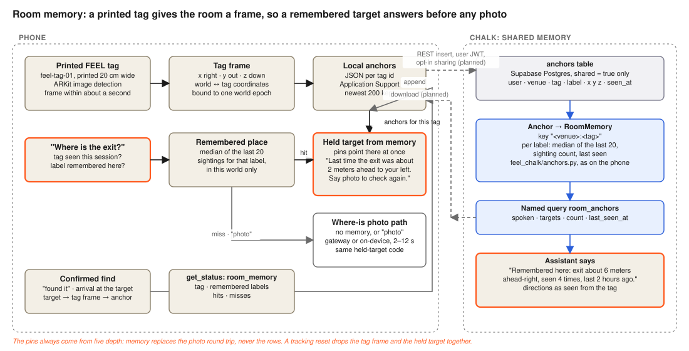
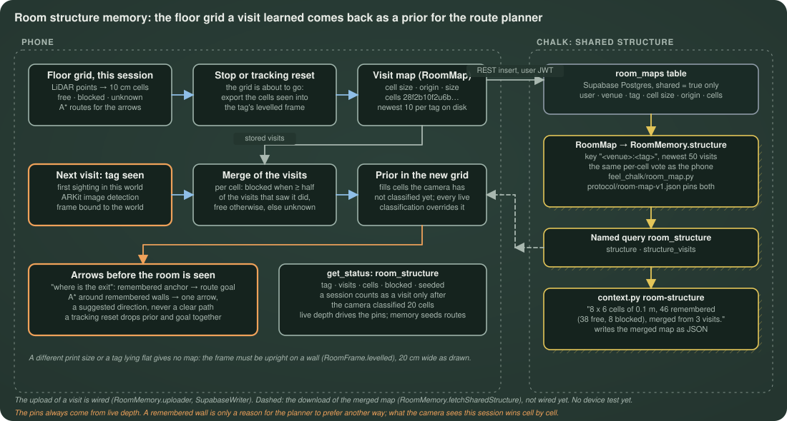

# FEEL context on Chalk

The features Chalk serves to FEEL's assistant, and the database they read. Deployed from `chalk/`
(`chalk.yaml` is there); queried by `python -m feel_chalk.context` and, later, by the phone.

| Feature class | Key | What it answers |
|---|---|---|
| `Find` | row id | One confirmed find: user, object, place, confidence, time (`found_at` is the feature time) |
| `ObjectHistory` | `<user_id>:<object name>` | Latest confirmed place and time, count, and the sentence the assistant reads out |
| `VenueEntry` | entry id | One reviewed statement from an official HTTPS source, with effective dates |
| `Venue` | venue slug | The downloadable venue pack built from its entries, with its SHA-256 |
| `Anchor` | row id | One confirmed sighting of a target in a printed room tag's frame (x, y, z in metres), shared by its owner |
| `RoomMap` | row id | One visit's structural map of the room behind a tag: 10 cm cells (unknown, free, blocked) in the tag's levelled frame, run-length encoded, shared by its owner |
| `Journey` | row id | One walk from a tag toward a remembered target: the steps, the blocked cells seen, the cue latencies, whether it arrived; shared by its owner |
| `RoomMemory` | `<venue_id>:<tag_id>` | Per label, the median place of the last 20 sightings, the count, the newest time, and the spoken summary; the room's structure merged from the newest 50 shared visits; and the world map, that structure plus the last 60 days of shared journeys |
| `Path` | `<venue_id>:<tag_id>:<from_x>,<from_y>:<label>` | A suggested direction over the world map from that pose to the remembered target: the polyline, the progress points every 6 m, the length and a status |

Named queries pin inputs and outputs: `last_seen` (`ObjectHistory.id` → `spoken`, `last_place`,
`last_seen_at`, `finds_count`), `venue_pack` (`Venue.id` → `pack`, `pack_sha256`), `room_anchors`
(`RoomMemory.id` → `spoken`, `targets`, `targets_count`, `last_seen_at`), `room_structure`
(`RoomMemory.id` → `structure`, `structure_visits`), `path` (`Path.id` → `polyline`, `progress_points`,
`length_m`, `status`) and `progress_points` (`Path.id` → `progress_points`, `status`). The scheduled query
`world_map` recomputes `RoomMemory.world_map` daily for every room with a shared visit or journey.

The sentences, the pack, the remembered places, the maps and the path are produced by `feel_chalk/history.py`,
`feel_chalk/venue_pack.py`, `feel_chalk/anchors.py`, `feel_chalk/room_map.py`, `feel_chalk/journeys.py` and
`feel_chalk/path.py`, the same code the local tools use, so `tests/test_history.py`, `tests/test_anchors.py`,
`tests/test_room_map.py`, `tests/test_journeys.py`, `tests/test_path.py` and `tests/test_feel_context.py`
cover them without a deployment, a pack built by Chalk is byte-identical to one built locally, and the phone
aggregates anchors, merges maps and scores journeys exactly as Chalk does (`protocol/room-memory-v1.json`,
`protocol/room-map-v1.json` and `protocol/journey-v1.json` are the vectors both sides must reproduce).

## The database, and what the Supabase values are for

`chalk/.env` now has `SUPABASE_URL` and `SUPABASE_PUBLISHABLE_KEY`. Those are the project's **API**
address and anon key: what the phone uses (with a signed-in user) to write confirmed finds, anchors,
room maps and journeys through Supabase's REST API under row-level security (`SupabaseWriter` in the app).

Chalk does not use either. Its PostgreSQL data source connects to the **database** behind that
project, so it needs host, port, database name, user and password. On Supabase they are under the
**Connect** button → **Session pooler** (IPv4, port 5432, database `postgres`); the user is written
`<role>.<project ref>`. Give Chalk its own read-only role rather than `postgres`: `sql/access.sql`
creates `feel_chalk`, grants it select, and adds the row-level-security policies it needs (a plain role
is subject to RLS too, so without them Chalk would read zero finds).

Then:

1. Run `chalk/sql/schema.sql` in the Supabase SQL editor, then `chalk/sql/seed.sql` for the demo rows, then
   `chalk/sql/access.sql` with a generated password in place of the placeholder.
2. In the Chalk dashboard, Data Sources → Add → PostgreSQL, **name `feel_finds`**: the session pooler host and
   port 5432, database `postgres`, user `feel_chalk.<project ref>`, that password.
   Chalk's "test connection" must pass before a deployment can resolve anything.
3. Install the Chalk CLI (`curl -s -L https://api.chalk.ai/install.sh | sh`). With `CHALK_CLIENT_ID` and
   `CHALK_CLIENT_SECRET` exported from `chalk/.env` no browser login is needed. Then from `chalk/`:
   `chalk environment <CHALK_ENV_ID>` and `chalk apply --await --force`. `chalk.yaml` names the Chalk project
   ("Default", the one that owns the environment); `.chalkignore` keeps tests, evaluations and data out of the upload.
4. Verify from this Mac (service token in `chalk/.env`):

```sh
python -m feel_chalk.context last-seen --user 00000000-0000-0000-0000-000000000001 --object keys
python -m feel_chalk.context venue-pack --venue harvard-yard --output data/harvard-yard-from-chalk.json
python -m feel_chalk.context room-anchors --venue harvard-yard --tag feel-tag-01
python -m feel_chalk.context room-structure --venue harvard-yard --tag feel-tag-01 --output data/harvard-yard-structure.json
python -m feel_chalk.context path --venue harvard-yard --tag feel-tag-01 --from=-0.3,0.3 --label exit
```

The first prints "Keys: last confirmed at the kitchen table, 2 hours ago (2 finds on record)." from the
seed rows. The second writes a pack the phone accepts unchanged. The third prints "Remembered here: exit
about 6 meters ahead-right, seen 4 times, last 2 hours ago; water fountain about 3 meters ahead-left, seen
twice, last yesterday." and one line per remembered target. The fourth prints "Room structure at
harvard-yard:feel-tag-01: 8 x 6 cells of 0.1 m, 46 remembered (38 free, 8 blocked), merged from 3 visits."
and writes the merged map the phone reads with FeelCore `RoomMap`. The fifth prints "Suggested direction to exit
at harvard-yard:feel-tag-01: 7.1 m over the remembered map, 2 progress points; the live camera decides each step."
and the two points of `protocol/journey-v1.json`. A database that ran the earlier files before the `room_maps`
or `journeys` tables existed gets them from `sql/upgrade-room-maps.sql` and `sql/upgrade-journeys.sql`.

First live deployment and the verified queries are recorded in
[docs/evidence/chalk-context](../../docs/evidence/chalk-context/QUERIES.md).

The phone's writes are in: a find after "found it", an anchor after every confirmed Where-is target, a visit's map
when sensing stops and each kept journey go through Supabase REST with the user's JWT (`SupabaseWriter`, behind
`RoomMemory.uploader` and `JourneyLog.uploader`), filed under the loaded venue pack's venue or `rubenstein-treehouse`
and marked shared unless the user turned sharing off. Uploads require explicit consent, sign-in and a selected
venue; public room sharing requires a separate opt-in; both choices default off. No demo venue is invented.

The phone's reads are in too (`ios/Lantern/Services/ChalkContext.swift`): the `last_seen` assistant tool runs the
`last_seen` named query for the signed-in user and speaks `ObjectHistory.spoken` as written; the first sighting of a
tag in a run fetches `room_structure` (the merged map becomes one visit in the phone's store and seeds the route
planner) and `room_anchors` (the remembered targets become sightings in its anchor store). See "How the phone
reaches Chalk" below. Still not done: a scheduled query that rebuilds each venue's pack daily (`ScheduledQuery` over
`Venue.pack`; `queries.py` is where it goes).

## How the phone reaches Chalk

The phone must never hold `CHALK_CLIENT_SECRET`, and `api.chalk.ai` does not answer online queries: the token
grant names the environment's engine host (`engines[CHALK_ENV_ID]`), and the engine wants the bearer token plus
`X-Chalk-Env-Id`, `X-Chalk-Client-Id` and `X-Chalk-Deployment-Type: engine`. Three ways were weighed:

1. **The phone's restricted router key** (`FEEL_CHALK_KEY`, the Model Gateway key it already uses for
   `/v1/router/chat/completions`). Not taken: whether the engine's `/v1/query/online` accepts a router key could not
   be checked from this session (the probe against the live engine was blocked), and the phone would still need the
   engine host, which only a token grant provides. To check it yourself: run the token exchange as `context.py`
   does, then POST the `last_seen` body to `{engine}/v1/query/online` with `Authorization: Bearer <router key>` and
   the three headers; a 200 with `object_history.spoken` means the key works and `ChalkQueryAccess` could take it.
2. **A short-lived query token minted on the Mac** — the choice. `python -m feel_chalk.query_token` exchanges the
   service credentials for an access token and prints the three build-config lines
   (`FEEL_CHALK_QUERY_ENGINE`, `FEEL_CHALK_QUERY_TOKEN`, `FEEL_CHALK_CLIENT_ID`); `ios/scripts/supabase_config.sh`
   pipes them into the git-ignored `ios/Config/Supabase.local.xcconfig` with the other keys, so the token travels
   through the pipe only and the terminal shows when it expires. Limits: the token is the service token itself,
   scoped to the environment, so a phone build carries full query rights for as long as the grant lasts
   (`expires_in`; rerun the script before the demo build, and never ship such a build beyond the demo phone).
   The phone reads the token's `exp` to skip a doomed query; an expired or missing token makes every read fail with
   `access` and the phone keeps its own stores.
3. **A proxy in the voice token service** (`services/voice-token`, `feel-v1-voice.vercel.app`): the service would hold
   the Chalk credentials and forward the two named queries for a phone with a FEEL access token. The right shape for
   a release (per-user limits, the secret in one place, no rebuild for a token), not done for the demo: it needs a
   deploy that could not be verified here.

Covered on this Mac by `chalk/tests/test_query_token.py` (the exchange and the lines, with a fake transport) and the
app's `ChalkContextTests` and `SharedMemoryTests` against a stub server. Nothing has read from the live engine from a
phone or a simulator yet.

## Room memory



**The tag.** ARKit's world origin changes every session, so a position remembered yesterday means nothing
today on its own. FEEL fixes the room with a printed tag: `ios/Lantern/Resources/feel-tag-01.png`
(drawn by `ios/scripts/make_room_tag.py`), printed **20 cm wide** and hung flat at about chest height.
ARKit image detection recognizes it within about a second and gives its image anchor; the app tells ARKit
the 20 cm width, so a tag printed at another size would put every remembered place at the wrong distance.
The anchor is the room frame: x to the right along the tag, y out of the tag into the room, z down along
the tag, in metres. The phone stores every confirmed target ("found it", or arriving at a Where-is target)
in that frame, and on the next visit a "where is the exit?" with the tag seen points the pins at once
("Last time the exit was about 2 meters ahead to your left. Pins point there. Say photo to check again.")
instead of taking a photo. The photo path is one word away, and the pins never stop showing live depth.

**What Chalk aggregates.** `Anchor` rows whose owner set `shared = true` are read per
`<venue_id>:<tag_id>`; `RoomMemory` resolves them per label into the per-axis median of the last 20
sightings (one bad confirmation moves nothing much), the sighting count and the newest time, as a JSON
list the phone can read with FeelCore's `RememberedTarget`, plus a spoken summary. Directions in that
summary are for someone standing at the tag with their back to it ("ahead-right"); the phone's own cue is
relative to the user because it knows their pose. Everything is phrased as a past sighting; nothing says
where a thing is now.

**Privacy.** Anchors are personal data: a user id, a word, a position relative to a named tag in a named
venue, and a time; together they say where someone was and when. They stay on the phone by default. A row
reaches the shared memory only when the user opted in (`shared = true`, enforced by the row-level security
policies in `sql/schema.sql` and `sql/access.sql`), and Chalk reads nothing else. Keep retention limited and
deletion possible before anything leaves the demo. No photo, audio or GPS coordinate is ever part of an anchor.

## Room structure



**What the phone keeps.** While sensing runs, FeelCore's `FloorGrid` classifies 10 cm floor cells from LiDAR as free
or blocked for the route arrows and forgets them when the session stops or tracking resets. With a printed tag in
view, the grid is first exported into the tag's levelled frame (`RoomMap`: cell size, origin, width, height and
run-length encoded cells) and stored per tag as one visit (`RoomMemoryStore`, the newest ten), provided the camera
classified at least 20 cells. On the next visit the first sighting of the tag in a world seeds the new session's grid
with the merge of the stored visits as a prior, so "where is the exit" with a remembered exit anchor gives a route
arrow before the camera has seen the room. The prior fills only cells the camera has not classified yet; every live
classification overrides it, a tracking reset drops it with the world, and the pins never read it.

**What Chalk merges.** `RoomMap` rows whose owner set `shared = true` are read per `<venue_id>:<tag_id>`;
`RoomMemory.structure` is the per-cell vote over the newest 50 visits: blocked when at least half of the visits that
observed the cell saw it blocked (a tie goes to blocked, since a missed wall costs more than a spurious one the live
camera overrides), free otherwise, unknown where no visit looked. Walls persist; a chair that moved is gone after two
more visits that see the floor there. `feel_chalk/room_map.py` is the same rule as FeelCore's `RoomMap.merge`,
`protocol/room-map-v1.json` is the vector both must reproduce, and `sql/seed.sql` carries its three visits, so
`room-structure --venue harvard-yard --tag feel-tag-01` prints the merged 8 × 6 map. The phone uploads a visit through
`RoomMemory.uploader` (`SupabaseWriter`) and, the first time it sees the tag in a run, downloads the merged map
(`RoomMemory.fetchSharedStructure`, over `ChalkContext.roomStructure`) as one more visit in its store, so a first visit
can route; the device test of the tag this all depends on is pending.

**Privacy.** A visit map says which cells of a named room someone walked through, so it is personal data like an
anchor: it stays on the phone unless the user opted in, and Chalk reads only shared rows (`sql/access.sql`). It holds
no photo, audio or GPS coordinate, and nothing in it is a claim about the room now: a remembered wall is only a reason
for the planner to prefer another way.

## Journey loop

Every walk is a journey, journeys and scans make the room's map, a path is planned over that map, and holdout
journeys score each path version. Box by box:

| Box | Code |
|---|---|
| Journey (every walk, stored in Chalk) | `journeys` table (`sql/schema.sql`, `sql/upgrade-journeys.sql`), `Journey` feature, `feel_chalk/journeys.py` (`from_row`, `usable`); the record is `protocol/journey-v1.json` |
| Room map, held 60 days | `RoomMemory.world_map`: `resolvers.room_world_map` merges `RoomMemory.structure` with the shared journeys of the last 60 days through `journeys.world_map` (a cell a step stood in is free, a cell an obstacle was seen in is blocked, obstacle over step, both over the structure's vote); `journeys.within_days` is the window |
| World map, scheduled | `ScheduledQuery` `world_map` (`queries.py`), daily at 04:00 over the room ids the cron resolver `rooms_with_memory` ingests; today it combines scans (the merged structure) and journeys, floor plans and venue facts are not yet inputs |
| Path, pose to remembered target | `Path` feature keyed `<venue>:<tag>:<from_x>,<from_y>:<label>`; `resolvers.suggested_path` reads the target from `RoomMemory.targets` and plans with `feel_chalk/path.py` (A* on half-metre cells: free 1, unknown 2, plus 1 next to a blocked cell, blocked never entered except the target); named query `path` |
| Progress points every 6 m, for the pins | `path.progress_points` (the first 6 m in, the target last); named query `progress_points`; `context.py path` prints them |
| Evaluation on frozen holdout journeys | `feel_chalk/journey_eval.py` over an export of the table split by `protocol/journey-holdout.json`; scores arrived, min clearance, path efficiency and cue latency p95 per journey (`journeys.score`), ranks collisions first, then efficiency, then latency (`journeys.rank`), and says `promote: yes` for a candidate export only when it is better in that order |

A path is a suggested direction over remembered cells, never a claim that the way is clear or safe; the live
camera decides each step, and the pins never read the map. Journeys are personal data like anchors (where
someone walked and when): they stay on the phone unless the user opted in, and Chalk reads only shared rows.
The phone writes each kept journey (`JourneyLog.uploader`, `SupabaseWriter`); the device test of the whole loop is pending.

## Privacy

Finds are personal data: a user id, an object word, a place and a time. Keep them under the
user's own account, never share across users without consent, and give retention a limit before
anything leaves the demo. No photo, audio or coordinate ever reaches this database.
