# FEEL evaluation, model selection and real-data research

October 17, 2026. Research and implementation proposal. No model winner, new route, dataset upload or application feature results from this investigation. Main remains V1; V4 findings refer to its isolated snapshot.

## Decision

Compare the two configured models on the same frozen cases before adding more providers. Select by task. Reject candidates with unacceptable behavior before comparing latency and cost; a good average must not hide incorrect actions or invented locations.

## What Chalk supplies

Evaluations pin data, task and scorer versions. Dataset uploads create revisions, which can be reused across candidates. A completed run still needs row counts and error-column checks. [Datasets](https://docs.chalk.ai/docs/evaluations/datasets), [results](https://docs.chalk.ai/docs/evaluations/results).

Use deterministic scorers for action fields, object labels, schema validity and cancellation outcomes. Chalk also offers LLM judges for subjective qualities and an escalating judge called `jev`; its self-reported confidence is not calibrated. Use human-rated examples to check a judge before trusting it. [Scorers](https://docs.chalk.ai/docs/evaluations/scorers).

Local inspection found `json_valid`, `json_match`, `llm_judge`, `jev` and `sql` in installed chalkcompute 2.13.7. No scorer was instantiated: construction can deploy resources. This is API availability, not a hosted execution test.

The official overview and quick start disagree about environment prerequisites. The quick start says managed self-signup environments enable the queue by default and need no resolver deployment. Our previously submitted smoke run lacks a verified result, so resolve its execution state rather than assuming either document proves readiness. [Overview](https://docs.chalk.ai/docs/compute/evaluations), [quick start](https://docs.chalk.ai/docs/evaluations/quick-start).

## Existing code versus missing measurements

| Area | Implemented | Missing for selection |
|---|---|---|
| V1 photo evaluation | Input validation/hashes, phone-style JPEGs, center-hit correctness, reply parsing, false-found indicator | Absent-only false-positive rate, present-only localization rate, per-case timing/usage, stable case identity and independent holdout enforcement |
| V4 command evaluation | Expected-field agreement, allowed destination IDs, tracking checks, latency percentiles | Real-user holdout, cost, paired comparison, raw model errors versus guard interventions |
| Hosted execution | Generic dataset and functions registered during previous setup | Verified completed smoke results, then approved real-data runs |
| Grounded venue answers | Research only | Source ingestion, retrieval, provenance, expiry and scoring |

Source audit findings:

- `chalk/feel_chalk/where_is_eval.py` averages the false-found indicator across all rows. That is a count normalized by the entire dataset, not the absent-target false-positive rate. Malformed replies also score zero on this indicator; show them separately.
- `chalk/feel_chalk/gateway.py` returns response text without usage metadata and configures a 60-second request timeout. `ios/Lantern/Services/WhereIsService.swift` configures 12 seconds. The phone's shared URL session does not enforce a 12-second absolute wall-clock deadline. Implement a common total usable-response deadline before comparing timing; answers after it must not count as usable successes.
- `chalk/feel_chalk/eval_data.py` hashes inputs but accepts only image/question/box labels. It cannot enforce session-separated holdout or record provenance. A companion manifest or a versioned schema is needed.
- V4 `services/chalk/evaluate.py` scores the validated pipeline. Some unsafe model proposals get corrected before scoring, and stop bypasses the model. Record intervention rates separately from final action correctness.

## Proposed evaluation sets

| Set | Source | Main measurement |
|---|---|---|
| Photo localization | Consented FEEL captures with human-checked boxes, including absent targets | Correct instance, center hit, false-found/absent count, malformed replies |
| Answerability | Reviewed VizWiz examples in a separate VQA task | Recognizing when the image cannot answer the question |
| Voice actions | Consented commands plus labeled synthetic edge cases | Correct permitted action, clarification, cancellation, mute behavior |
| Venue knowledge | Reviewed official documents with versioned evidence passages | Supported claims, retrieval success, correct abstention and time validity |

VizWiz contains photos and spoken questions contributed by blind people, with human answer and answerability labels. The publisher lists CC BY 4.0 and reports that its hosted evaluation servers were retired in April 2026, with annotations available for self-evaluation. Retain attribution and dataset version. [VizWiz-VQA](https://vizwiz.org/tasks-and-datasets/vqa/).

VizWiz VQA labels are not FEEL bounding boxes or LiDAR ground truth. Keep its score separate, and treat this public benchmark as diagnostic because unknown pretraining exposure can affect results. No images were downloaded or sent to a provider in this investigation.

Start with the existing proposed 30-photo pilot to discover mistakes, not establish production reliability. Split later data by capture session and location before prompt tuning; keep near-duplicate frames together. Freeze the holdout. Repeated calls on the same photo measure variability, not additional independent scenes.

Record opaque case ID, source category, dataset version, capture group, split, annotation reviewer, consent/license reference, source time and expected outcome in the companion manifest. Keep personal material and recordings outside Git. Upload only the reviewed subset covered by the required authorization.

## Model selection protocol

1. Use identical normalized inputs, prompt version, tool schema and relevant context for both candidates. Save requested and resolved model IDs, date, parameters and exact input hashes.
2. Interleave candidate requests at comparable load. Separate cold-start/queue delay, provider time and phone end-to-end time. Implement and apply the same absolute usable-response deadline in the app and evaluation; retain timeout/error rows.
3. Score correctness by task and scene condition. For photos, report false-found count divided by absent rows, present localization accuracy, malformed replies and missing responses. For commands, distinguish raw invalid proposals, guard interventions and executed actions.
4. Compare the same case IDs. Inspect disagreements and report uncertainty grouped by independent capture session. Review every critical failure; do not optimize one weighted score that trades incorrect actions for cheaper requests.
5. Among acceptable candidates, compare p50/p95 latency, deadline-success rate and measured cost per usable correct result. Include retries and judge overhead. Missing usage means unknown cost, not zero. Pin any pricing table to its retrieval date.
6. Keep the current route unless the held-out evidence supports a change. Retest on the phone before any rollout. Preserve a rollback target and version the decision report.

Proposed pilot gates retain the existing documentation's requirements: complete rows, valid replies, zero observed false-found cases and at least 90% present localization. These are project targets, not validated safety thresholds. Zero observed errors in a small set cannot establish a zero population error rate.

Chalk's route judge selects a backend; it is different from an evaluation judge grading outputs. Shadow routing records a selection without comparing both models' generated answers. Its remote classifier reads bounded text rather than the embedded image. Start with explicit task routes and an offline paired comparison. Fallback handles certain transport/provider failures, not a semantically wrong answer. [Model Gateway](https://docs.chalk.ai/docs/model-gateway).

## Real information with source and time

Harvard's official accessibility page links campus accessibility maps and publishes temporary gate restrictions alongside normal schedules. It also warns that opening information can lag changes. This is a useful real-data test: a current exception must take precedence over a general schedule. Do not turn a listed entrance into a claim that the route is currently clear. [Harvard campus access](https://accessibility.harvard.edu/campus-access).

The Map Collection page distinguishes step-free access depending on whether the visitor has a Harvard ID. A grounded answer must preserve that condition rather than returning one entrance for everyone. [Harvard Library accessibility](https://library.harvard.edu/libraries/harvard-map-collection/about/accessibility).

Proposed source records contain URL, publisher, retrieved-at timestamp, content hash, effective dates when explicit, reviewed evidence passage and refresh policy. Retrieval time alone does not prove a fact remains true. Missing validity or conflicting sources must remain visible in the answer.

Chalk can query feature values with staleness constraints and replay historical context with `input_times`. Replay every tool lookup against the same historical cutoff so later information cannot leak into an earlier test. Those mechanisms still require FEEL's ingestion, source verification and identity checks. [Dynamic queries](https://docs.chalk.ai/docs/compute/dynamic-chalk-queries).

Test retrieval and answer generation separately. First check whether the correct passage appeared among retrieved results; then check claim support, preserved conditions, source references and abstention when evidence is missing. Use human labels for factual correctness, deterministic checks for dates/IDs and an optional calibrated rubric for wording. Treat retrieved instructions as source data, never as app permissions.

## Boundaries and next implementation

```mermaid
flowchart LR
    Data[Reviewed real data and labeled synthetic cases] --> Freeze[Frozen development and holdout sets]
    Freeze --> Models[Same cases through each candidate]
    Models --> Checks[Deterministic scores and row errors]
    Checks --> Review[Human review and optional calibrated judge]
    Review --> Gate[Quality gates then latency and cost]
    Gate --> Phone[Supervised phone verification]
    Phone --> Route[Versioned route choice]
```

Implement denominator fixes and telemetry first, then the paired report and provenance manifest. Resolve hosted execution before uploading approved photos. Build source-grounded venue answers as a separate feature with separate tests. Keep the existing OpenAI audio path, local stop/mute, tracking validation and haptic control intact. Natural voice quality, interruption and headphone delivery require real audio/device tests and blind-user feedback.
