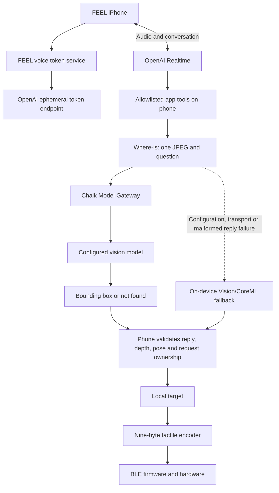
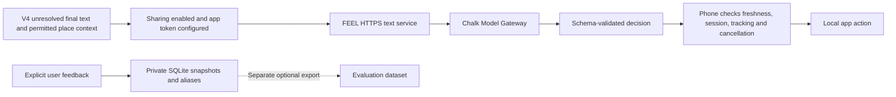
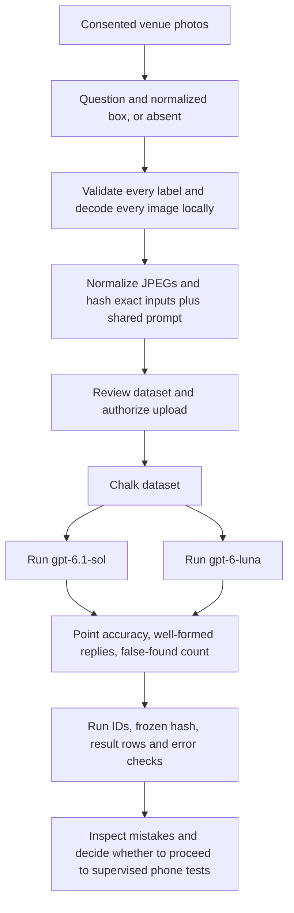

# Chalk implementation and evaluation readiness

> Production setup follow-up: trace content logging is now disabled, support has received the quota-backend blocker, and a synthetic infrastructure evaluation has been created. See [current production gates](CHALK-PRODUCTION.md). Historical statuses below describe the earlier audit.

Updated October 17, 2026. Baseline: V1 `main` at `4f3f8e5`; V4 inspected at `5f0ff56`. Main was fetched and pulled before this audit. V2, V3 and V4 remain separate branches.

## What is implemented

| Capability | Version | Implementation | Current Feel environment evidence |
|---|---|---|---|
| Voice conversation and app tools | V1–V4 | FEEL token service and direct OpenAI Realtime connection | Voice is separate from Chalk; unchanged by this setup |
| Photo Where-is | V1–V4 | One JPEG + question to Chalk; bounding box parsed locally; LiDAR/pose place the target | Routing configured; current-key photo and phone checks NOT RUN |
| Failure recovery | V1–V4 | 12-second gateway timeout; local Vision/CoreML fallback for missing configuration, transport or malformed replies | Source and offline tests; physical performance NOT VERIFIED |
| Cloud text interpretation | V4 only | HTTPS FEEL text service → Chalk → validated app action, with session/tracking/cancellation checks | Implemented in V4; service deployment and device provisioning pending |
| Feedback | V4 only | Private SQLite snapshots and session phrase aliases with separate retention consent | Does not train models or use Chalk feature-store queries |
| V4 command evaluation | V4 only | Gateway runner with frozen inputs, correctness/grounding/tracking/latency metrics; optional hosted evaluation of recorded outputs | No current-environment grounded-intent or hosted run verified |
| Photo evaluation | Main and later branches | Gateway task, three scorers, label checks and phone-style JPEG preprocessing | No uploaded dataset or hosted run found in selected environment |

A valid not-found reply or missing depth does not trigger the on-device fallback. Cloud output never directly commands a servo. The phone validates and encodes targets using the existing packet protocol.

## Runtime architecture

The V4 text service does not receive camera frames, microphone audio or coordinates. Voice audio goes directly to OpenAI. These are separate data paths and permissions.

## Configured in Chalk

- Team **Feel**, project **Default**, environment **production** (`flnyc749e8d9`).
- Connection **FEEL OpenAI**, routing enabled, provider prefix `openai/`.
- Key **FEEL app vision and commands**, restricted to `openai/gpt-6.1-sol` and `openai/gpt-6-luna`.
- Both models returned `OK` in two previously authorized generic text requests. Observed request times were 1.499 s and 2.310 s respectively; one sample each is not a latency benchmark.
- Read-only follow-up: router doctor passed both checks; dataset listing was empty; evaluation listing returned no evaluations or score summaries.
- Credentials are saved locally in ignored `chalk/.env`; no credentials belong in diagrams, fixtures or Git.

These checks establish routing. They do not establish image accuracy, model quality, deployed V4 service behavior or phone/hardware integration. No additional model is needed to start the comparison.

## Evaluation design

Start with 30 consented photos/questions, including at least 10 absent targets. Include doors, EXIT signs, chairs, desks and people who agreed to participate. Vary clutter, lighting, target position and distance. Label boxes on the upright, EXIF-corrected image. Have a second person check labels. Use identical inputs and prompt for both models and keep later holdout photos separate from prompt tuning.

Report each metric with its denominator:

- **Point accuracy:** predicted box centre inside the labeled box, or a correct absent answer, divided by all rows. Also separate present-target localization from absent-target accuracy.
- **Well-formed replies:** replies accepted by the same contract as the phone, divided by all rows. Gateway errors and malformed output must remain visible as failures.
- **False-found rate:** found replies on absent rows divided by absent rows. The scorer's mean over the entire dataset is not this rate. Zero false-found on 10 absent examples is only a small-sample result.

Proposed demo gate, not an achieved result: all rows complete without task/scorer errors; every reply well formed; no false-found on absent targets; at least 90% correct localization on present targets. Review every error regardless of aggregate score. These are project acceptance targets, not proof of mobility safety.

V4 already includes `services/chalk/evaluate.py`, `chalk_evaluation.py`, `export_feedback.py`, a held-out command fixture and report/boundary checks. Its hosted runner scores recorded outputs from real gateway runs; it does not perform fresh inference remotely. Mock runs are labeled and cannot establish model accuracy. This code remains on V4.

Photo scoring does not test depth, world placement, speech delivery or the puck. Separately exercise cancellation, changed AR session, missing depth, network failure, local fallback and late replies on the phone. For V4, also evaluate supported/unsupported commands, ambiguous references, stale context, explicit feedback and actions after Stop. Never turn cloud accuracy into a claim that a path is clear.

## What is still needed

1. **Dataset and upload permission.** Supply or capture consented venue images and labels. The earlier automatic approval review rejected sending a bundled CAD image and repository-derived context without specific authorization; neither payload was sent. Local validation can proceed before authorizing the exact dataset upload to Chalk and its configured provider.
2. **Hosted evaluation execution.** Pinned SDK dependencies are installed in a temporary local environment and the authenticated connection check passes. Run preflight, upload the approved dataset, and run both models. Confirm function/evaluation execution is enabled by actually completing a run. CLI login and empty lists alone do not prove that capability.
3. **Phone and V4 deployment.** Connect/unlock the iPhone for current-environment provisioning and supervised tests. Deploy/configure the separate V4 HTTPS text service on its branch before claiming V4 cloud commands work on-device.

No new provider credential or third model is currently required. Physical LiDAR/BLE/tactile validation remains pending independently of Chalk readiness.

## Reference

Chalk's [Evaluation quick start](https://docs.chalk.ai/docs/evaluations/quick-start) requires checking result row counts and task/scorer error columns even when the overall run succeeds. Feature definitions and resolvers are not prerequisites for this evaluation workflow. The installed SDK API is checked locally; deployment remains a separate unexecuted gate.
