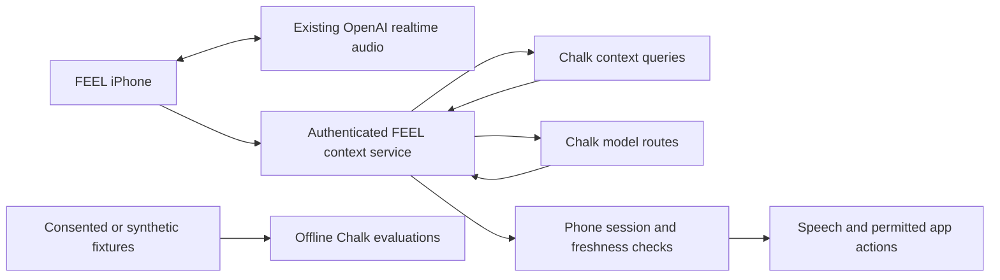

# Chalk opportunities for FEEL

Research date: October 17, 2026. These are proposed additions, not deployed features. Current account evidence and release blockers live in [CHALK-PRODUCTION.md](CHALK-PRODUCTION.md).

Follow-up: [evaluation, model selection and real-data research](CHALK-EVAL-RESEARCH.md) records source-backed options and gaps found in the actual runners.

Start with agent context and repeatable evaluations. FEEL already has a working voice path; keep its audio connection and immediate controls on the phone while adding bounded context tools behind the authenticated service.

## Product opportunities

| Priority | Capability | Proposed FEEL behavior | Dependency |
|---|---|---|---|
| First | Context queries | Speak when something relevant changes, without repeating the last cue. | Authenticated session context and phone-side freshness checks. |
| First | Evaluations | Compare command accuracy, brevity, abstention and response time before changing prompts or models. | A completed hosted smoke run and labeled fixtures. |
| Next | Model routes | Choose a tested model for each task and recover from supported provider failures. | Quality and latency evidence, active admission limits. |
| Later | Consented object history | Answer where an object was last observed, including when. | User isolation, deletion and explicit retention settings. |
| Later | Document retrieval | Answer questions about a venue's accessibility information from approved documents. | Maintained source documents and a search index. |
| Optional | MCP Gateway | Give a future personal assistant access to selected external services. | Per-user authorization and app-side action validation. |

Chalk's dynamic queries can fetch selected features with freshness requirements and enforce feature-tag permissions. Proposed context includes the active task, speech preference, last spoken cue and observation timestamp. Bind identity on the server; the model must not choose which user's records it reads. A cloud observation is historical context until the phone validates it against the current session. [Dynamic queries](https://docs.chalk.ai/docs/compute/dynamic-chalk-queries).

Example proposal: after the user asks for a chair, FEEL announces a newly confirmed chair once. It stays quiet while nothing relevant changes. Stop or a task switch invalidates pending actions; mute suppresses audio while preserving listening and authorized tool execution. The phone owns those decisions. Chalk does not make the microphone always active or supply iOS background execution.

## Tests worth building first

Chalk evaluations pin the dataset revision, task version and scorers, allowing comparable offline runs. They do not automatically improve or train the agent. Our hosted infrastructure run has not yet produced a verified result. [Evaluations](https://docs.chalk.ai/docs/compute/evaluations).

| Fixture | Expected FEEL behavior |
|---|---|
| Stop during an answer | Cancel output locally and invalidate pending actions. |
| Mute during an answer | Suppress current and late audio; preserve listening and authorized tool execution. |
| Repeated unchanged observation | Avoid repeating the same cue. |
| Old observation or tracking loss | Give no current directional claim from stale data. |
| Ambiguous command | Ask one short clarification without an unintended action. |
| Object absent or image unclear | Abstain rather than invent a location. |
| Another user's session identifier | Deny access before model execution. |
| Provider timeout or disconnect | Finish within the app deadline and use the appropriate local recovery. |
| Concise-answer instruction | Measure word count and task completion separately. |

Record latency distributions, incorrect actions, unsupported location claims and abstention. Text scorers cannot establish natural voice quality or headphone behavior; test those on the phone with consented listeners. Use reviewed feedback as regression cases rather than silently changing production behavior.

## Routing and memory limits

Start with explicit task routes. Chalk supports aliases and fallbacks for connection errors, timeouts, 429 and 5xx responses; a wrong answer does not trigger fallback. Shadow judging records routing proposals without switching the serving model, but remote judging costs tokens and sees bounded text rather than understanding embedded images. Bound the whole operation with FEEL's own deadline. Keep camera traffic off token budgets/TPM policies, which currently reject multimodal requests. [Model Gateway](https://docs.chalk.ai/docs/model-gateway).

Object history needs an explicit product contract. A proposed answer such as “Last seen on the desk two minutes ago” must preserve the observation time and uncertainty. Stored coordinates do not solve AR relocalization across sessions. Prefer session-only context first; add durable records only with deletion, consent and ownership tests.

## Venue information and external actions

Chalk documents a retrieval function that embeds a question and searches OpenSearch. FEEL could use that pattern for approved venue accessibility documents, returning source references with answers. This needs a separate maintained corpus and index; it cannot establish a currently clear walking route. The tutorial uses older client examples, so verify its API calls against the installed SDK before implementation. [RAG pipeline](https://docs.chalk.ai/docs/compute/rag-pipeline).

The MCP Gateway centralizes external tool connections, credentials and audit records. Its documented policies are deny-only, and policy evaluation errors can allow a request. Do not use this as FEEL's sole action boundary. Keep a server-side tool allowlist and ownership checks, plus phone-side validation. No MCP gateway was deployed during this investigation. [MCP Gateway](https://docs.chalk.ai/docs/mcp-gateway).

## Proposed architecture

The diagram describes a proposal. Current immediate stop/mute, tracking checks and haptic packet generation remain local. V4's separate text service is not a production multiuser backend. No new product feature or branch merge resulted from this research.
